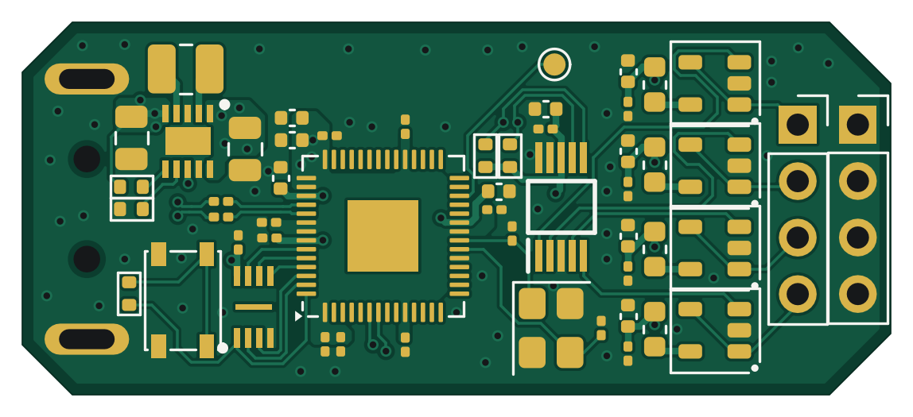
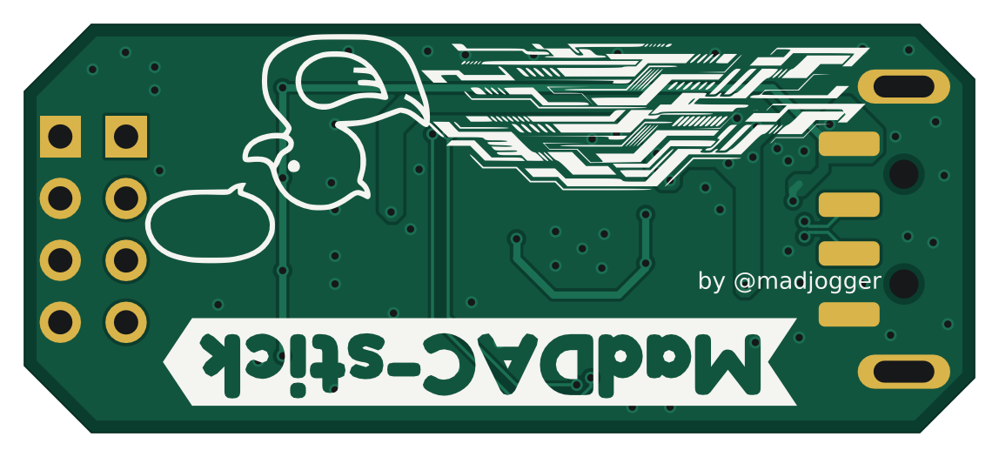

# MadDAC-stick

> USB stick with a **4-channel DAC**: **DAC6574** driven by an **RP2040**, every output buffered by its own **OPA320** op-amp.  
> Plug it into a USB-A port and get four programmable analog voltages.

<p align="center">
  
</p>
<p align="center">
  
</p>
<p align="center"><i>Board preview (top / bottom) generated from the KiCad board file</i></p>

---

## Overview

MadDAC-stick is the output half of a pair of USB "sticks" (see also [MadADC-stick](https://github.com/Madjogger1202/MadADC-stick)).  
The RP2040 controls a quad I²C DAC; each DAC output goes through a unity-gain **OPA320** buffer to a 4-pin socket, with a second 4-pin row of ground next to it.

---

## What's on the board

| Block | Part | Purpose |
|:--|:--|:--|
| MCU | **RP2040** | USB device, I²C master for the DAC |
| Flash | **W25Q16JV** | 16 Mbit QSPI flash |
| DAC | **DAC6574** | Quad 10-bit voltage-output DAC, I²C |
| Output buffers | 4× **OPA320** | Rail-to-rail voltage followers, one per channel |
| Supply filtering | 4× 10 nH + decoupling | Separate filtered supply for every op-amp |
| Power | **RT6150B-33** buck-boost | 5 V USB → 3.3 V |
| Clock | ABM8-272-T3 crystal | RP2040 reference clock |
| USB | USB-A plug | Power and data, plugs directly into a host port |
| Button | KMR221 | Boot button |

---

## Pinout

**RP2040 ↔ DAC6574**

| RP2040 GPIO | Signal | Notes |
|:--|:--|:--|
| GPIO4 | `SDA` | I²C data, 4.7 kΩ pull-up |
| GPIO5 | `SCL` | I²C clock, 4.7 kΩ pull-up |

DAC address pins `A0` and `A1` are tied to GND.

**Analog socket (2× 4-pin, 2.54 mm)**

| Pin | Row J2 | Row J3 |
|:--|:--|:--|
| 1 | `OUT A` (buffered) | GND |
| 2 | `OUT B` (buffered) | GND |
| 3 | `OUT C` (buffered) | GND |
| 4 | `OUT D` (buffered) | GND |

---

## Specifications

| Parameter | Value |
|:--|:--|
| Board outline | 39.0 × 16.8 mm |
| Layers | 2 |
| Thickness | 1.6 mm |
| Supply | 5 V from a USB-A port |
| Components | 53 |
| Revision | rev0 |

---

## Repository structure

```
MadDAC-stick.kicad_sch   — schematic
MadDAC-stick.kicad_pcb   — PCB layout
MadDAC-stick-backups/    — KiCad automatic backups
img/                     — board previews
```

---

## Development environment

- **Schematic & PCB:** KiCad 9
- **Firmware:** Pico SDK / Arduino-Pico / PlatformIO (RP2040) — not included in this repository

---

*by [@madjogger](https://t.me/madjogger)*
